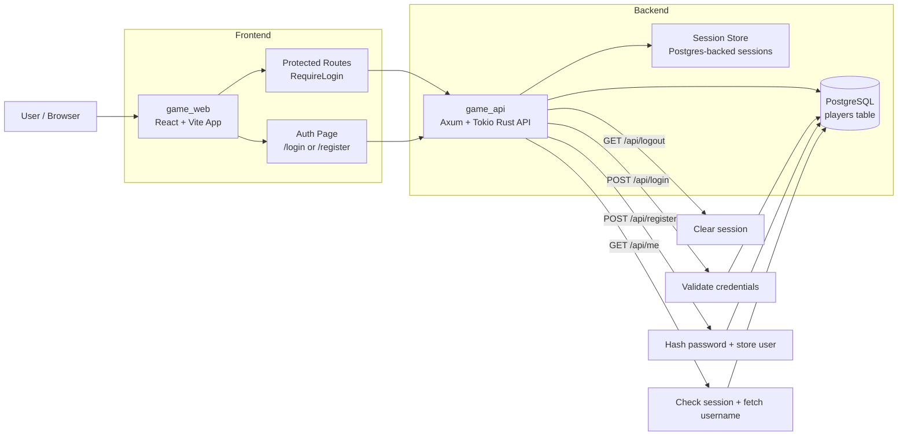

# The Imposter Up Game

This project is a full-stack browser game with a Rust API backend and a React frontend.

## Architecture Diagram



## Project Structure

- `game_web/` — frontend application built with React + TypeScript + Vite
- `game_api/` — backend API built with Rust and Axum

## Frontend Responsibilities

- Route management in `game_web/src/App.tsx`
- Authentication UI in `game_web/src/handlers/authmanager.tsx`
- Protected route guard in `game_web/src/component/requirelogin.tsx`
- Session-aware context in `game_web/src/pages/authcontext.tsx`

## Backend Responsibilities

- API server setup in `game_api/src/main.rs`
- Authentication handlers in `game_api/src/api/userauth.rs`
- Database creation logic in `game_api/src/api/dbhandler.rs`

## Authentication Flow

1. User signs in or registers from the frontend.
2. Frontend sends a request to the API.
3. Rust server validates input and hashes the password using Argon2.
4. The server stores session information in a Postgres-backed session store.
5. Protected pages call `/api/me` to verify the active session.
6. If the session is valid, the user can access game pages.

## Data Layer

The backend uses PostgreSQL and creates a `players` table with:

- `id`
- `username`
- `password_hash`
- `created_at`

## Notes

- The app uses server-side session validation for protected routes.
- The frontend redirects unauthenticated users to `/auth`.
- The backend listens on `127.0.0.1:12659`.

# The Imposter Up Game

A browser game with a React + TypeScript frontend and a Rust + Axum API.

## Project structure

- `game_web/` — React frontend built with Vite
- `game_api/` — Rust API, backed by PostgreSQL

The frontend sends API requests to `/api`. During local development, Vite proxies these requests to the backend at `http://127.0.0.1:12659`.

The API handles registration, login, session checks, and logout. PostgreSQL stores player accounts and server-side sessions; the API creates its application tables and applies the session-store migrations at startup.

## Run locally

### Prerequisites

- Git
- Rust toolchain (including Cargo)
- Node.js and pnpm
- PostgreSQL, with a local database created for the app

### 1. Get the code

```sh
git clone https://github.com/eyuele/theimpostergame.git
cd theimpostergame
```

### 2. Configure PostgreSQL and start the backend

Create a PostgreSQL database. For example, if PostgreSQL's command-line tools are installed:

```sh
createdb imposter_game
```

Create `game_api/.env` with a connection URL for that database:

```dotenv
DB_URL=postgres://localhost:5432/imposter_game
```

This example uses your local PostgreSQL defaults. If your server requires credentials or uses a different host or database name, adjust the connection URL accordingly. Keep this file local; do not commit credentials. On startup, the API creates its application tables and runs the session-store migrations. The PostgreSQL server and database must already exist.

In one terminal, run:

```sh
cd game_api
cargo run
```

The API listens on `127.0.0.1:12659`.

### 3. Start the frontend

In a second terminal, from the repository root, run:

```sh
cd game_web
pnpm install
pnpm dev
```

Open the local URL printed by Vite (usually `http://localhost:5173`). Keep both the API and frontend terminals running while using the app. Vite's `/api` proxy is configured in `game_web/vite.config.ts`.

## Validate changes

Run the checks for the part you changed. From the repository root:

```sh
(cd game_api && cargo fmt --check && cargo check)
```

```sh
(cd game_web && pnpm lint && pnpm build)
```

## Contributing and collaborating

Please work on a branch and open a pull request into `main`. Do not commit or push work directly to `main`, and do not force-push.

### Start a task

Update your local `main`, then create a descriptively named branch:

```sh
git switch main
git pull --ff-only origin main
git switch -c feature/short-description
```

Use names such as `feature/game-room`, `fix/login-error`, or `docs/local-setup`.

### Keep your branch up to date

Before pushing or opening/updating a pull request, merge the latest `main` into your feature branch:

```sh
git fetch origin
git switch feature/short-description
git merge origin/main
```

If Git reports conflicts, resolve them, test the result, and commit the merge if Git asks. If your push is rejected because the remote feature branch has new commits, fetch and merge that branch before trying again:

```sh
git fetch origin
git merge origin/feature/short-description
git push
```

Never use `git push --force` or `git push --force-with-lease`. If you are unsure how to resolve a conflict, stop and ask the branch's contributors for help rather than overwriting their commits.

### Push and open a pull request

Commit your changes on your feature branch and push that branch:

```sh
git add <files-you-changed>
git commit -m "Describe the change"
git push -u origin feature/short-description
```

Open a pull request from your branch into `main`. In the pull request description, explain what changed, why, how you tested it, and include screenshots for visible UI changes when useful. Ask for review and address discussion on the pull request before merging.

### Discuss work

For a bug or feature, open a GitHub issue before substantial work when possible. Describe the expected behavior and actual behavior, include steps to reproduce bugs, and add relevant screenshots or error messages. For quick questions or implementation details, use the relevant issue or pull request so the conversation stays with the work. Be respectful, explain trade-offs, and ask before taking over another contributor's branch.
