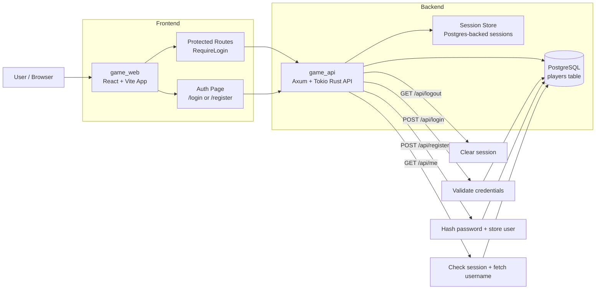

# The Imposter Up Game

This project is a full-stack browser game with a Rust API backend and a React frontend.

## Architecture Diagram

## Project Structure

- `game_web/` — frontend application built with React + TypeScript + Vite
- `game_api/` — backend API built with Rust and Axum

## Frontend Responsibilities

- Route management in `game_web/src/App.tsx`
- Authentication UI in `game_web/src/handlers/authmanager.tsx`
- Protected route guard in `game_web/src/component/requirelogin.tsx`
- Session-aware context in `game_web/src/pages/authcontext.tsx`

## Backend Responsibilities

- API server setup in `game_api/src/main.rs`
- Authentication handlers in `game_api/src/api/userauth.rs`
- Database creation logic in `game_api/src/api/dbhandler.rs`

## Authentication Flow

1. User signs in or registers from the frontend.
2. Frontend sends a request to the API.
3. Rust server validates input and hashes the password using Argon2.
4. The server stores session information in a Postgres-backed session store.
5. Protected pages call `/api/me` to verify the active session.
6. If the session is valid, the user can access game pages.

## Data Layer

The backend uses PostgreSQL and creates a `players` table with:

- `id`
- `username`
- `password_hash`
- `created_at`

## Notes

- The app uses server-side session validation for protected routes.
- The frontend redirects unauthenticated users to `/auth`.
- The backend listens on `127.0.0.1:12659`.
